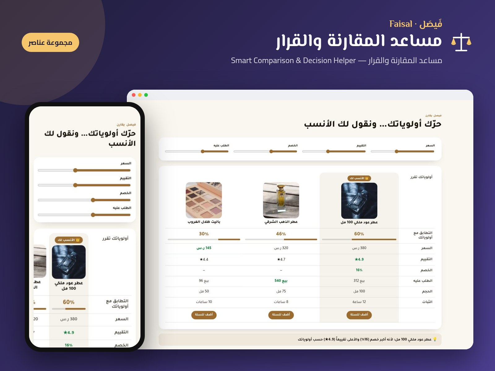
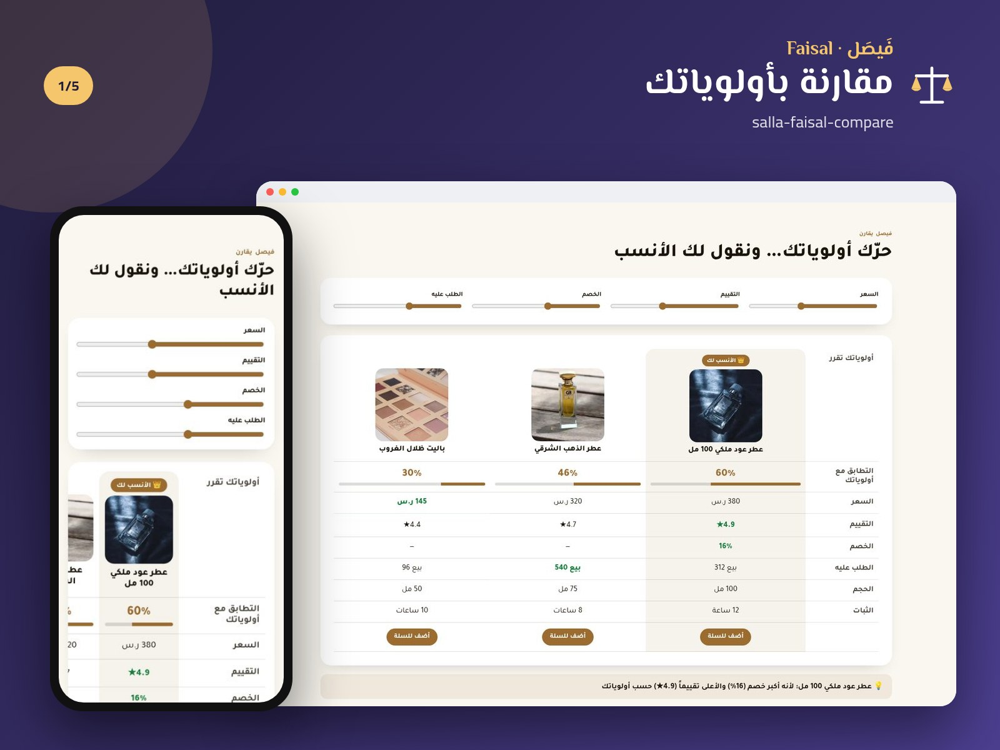
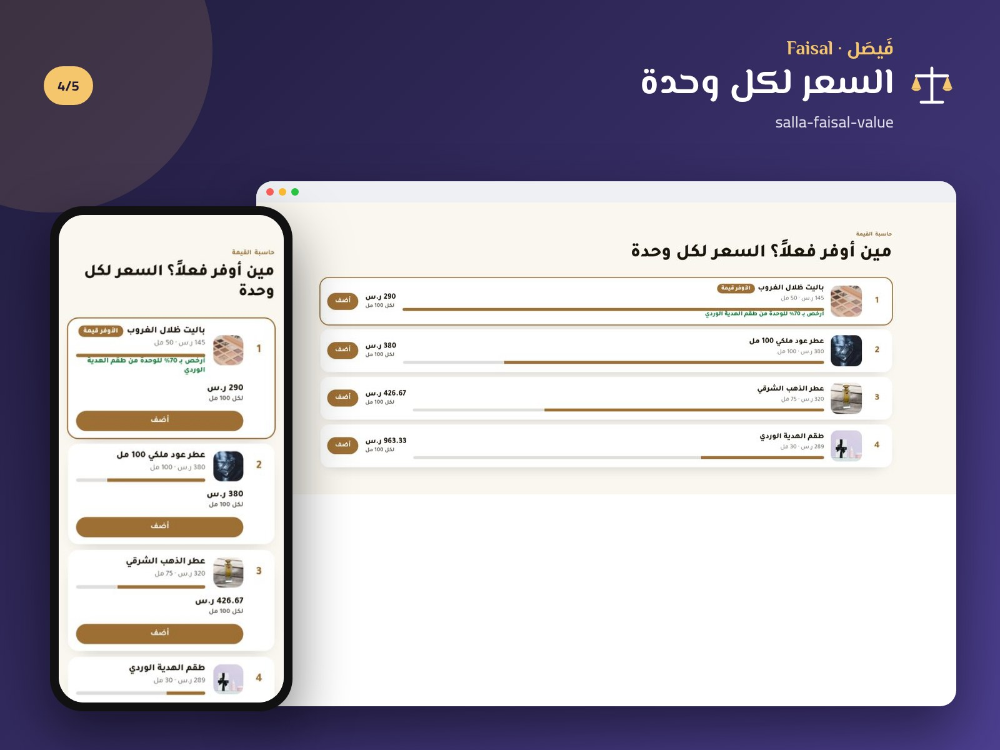

# فَيصَل — مساعد المقارنة والقرار
**Faisal — Smart Comparison & Decision Helper** — Twilight Component Bundle لمتاجر سلة (ثيم رائد وأي ثيم يدعم Twilight).

5 عناصر تحسم تردد العميل: مقارنة بأشرطة أولويات تتغير معها التوصية وسببها، «اختر وقارن» يتذكر ما شاهده، مواجهة وجهاً لوجه، حاسبة السعر لكل وحدة تقرأ الحجم من اسم المنتج، و«أنت من أي نوع؟» تبني الشخصيات تلقائياً من بيانات متجرك — كل الأرقام من منتجاتك الحقيقية.

5 components that end hesitation: priority-slider comparison with a live recommendation and reason, pick-and-compare that remembers what was viewed, head-to-head duel, price-per-unit calculator reading sizes from product names, and a shopper-persona picker built automatically from your store data — every number comes from your real products.

| العنصر | الوظيفة | عدد الإعدادات |
|---|---|---|
| `salla-faisal-compare` | مقارنة بأولوياتك | 64 |
| `salla-faisal-picker` | اختر وقارن | 58 |
| `salla-faisal-duel` | وجهاً لوجه | 51 |
| `salla-faisal-value` | السعر لكل وحدة | 48 |
| `salla-faisal-fit` | أنت من أي نوع؟ | 56 |

**مجموع الإعدادات: 277** — تشمل لكل عنصر 30 إعداد تصميم موحد (السمة، الألوان، الخط، المسافات، الحركة، الجدولة، الإخفاء حسب الجهاز، مساعد الإعداد داخل المحرر).

## ذكاء العناصر
- **للتاجر:** إذا تُركت المنتجات فارغة يختار العنصر تلقائياً من بيانات متجرك (الأكثر مبيعاً، الأحدث، العروض…) ويكتب نصوصاً جاهزة بالعربية والإنجليزية، مع مساعد إعداد يظهر داخل المحرر فقط.
- **للعميل:** ذاكرة على جهاز العميل فقط (localStorage) لما شاهده وأضافه، لترتيب الاقتراحات — بدون أي بيانات شخصية تُرسل.
- **بدون أرقام مزيفة:** المخزون والمبيعات والتقييمات والخصومات وتواريخ انتهاء العروض تُقرأ من بيانات سلة الحقيقية فقط، وما لا يتوفر لا يُعرض.

## التطوير
```bash
pnpm install
pnpm run build        # vite build — dist/<component>.js
pnpm run build:split  # كل عنصر في ملف مستقل
```
المعاينة المحلية بالبيانات التجريبية: `demo/index.html` (بيانات عينة فقط).

## صور






